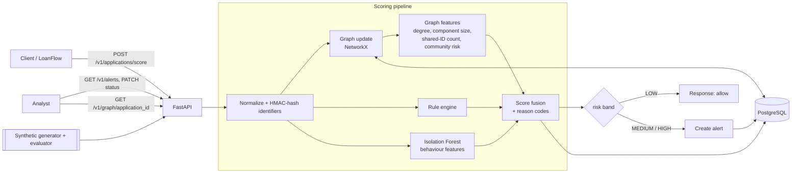
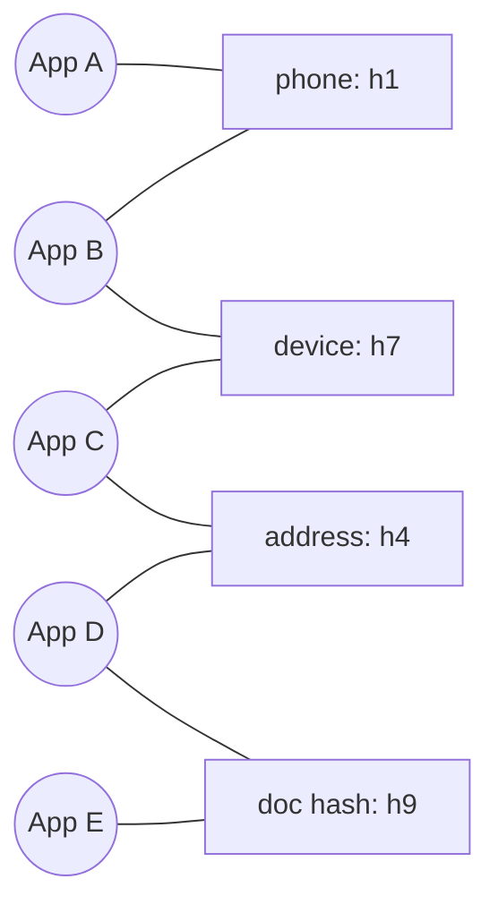
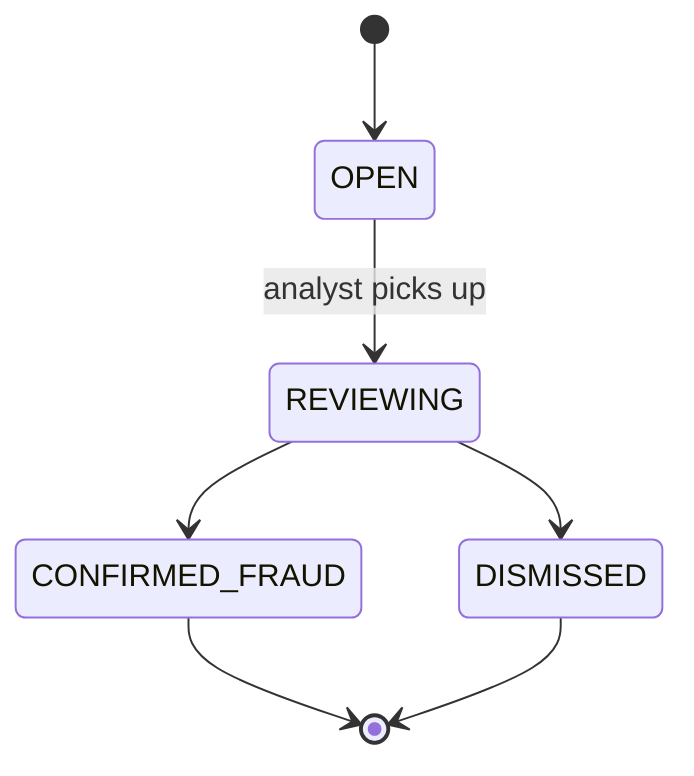

# LinkGuard: Graph-Based Fraud Detection Service

A real-time fraud scoring API that detects **synthetic identities and fraud rings** in loan applications by building an **identity graph**: applicants linked through shared phone numbers, devices, addresses, emails and document hashes. Graph signals, rules and an anomaly model are combined into one explainable risk score, and suspicious applications flow into an analyst review queue.

> Uses synthetic data only. No real PAN, Aadhaar or personal data. Not affiliated with any financial institution.

---

## Why this project

Per-application models (including Isolation Forest on its own) miss the most damaging lending fraud: **many applications that look normal individually but are connected**, such as one device behind 12 "different" people, or a ring of identities sharing addresses and documents. LinkGuard treats this as a **graph problem**:

- Identifiers are **nodes**, applications are linked to them by **edges**, and rings show up as dense connected structures.
- Each score comes with **reasons**, so an analyst sees *why* it was flagged and can view the connected neighbourhood.
- Identifiers are **hashed (HMAC-SHA256)** before storage, so the graph never holds raw PII.
- A built-in **synthetic fraud generator** injects labelled rings, so detection quality is **measured**, not claimed.

---

## Status

| Module | Status |
|---|---|
| Synthetic data generator (normal + injected fraud rings) | ☐ Planned |
| Identifier hashing + ingestion | ☐ Planned |
| Identity graph builder (NetworkX) | ☐ Planned |
| Graph features + community detection | ☐ Planned |
| Rule engine | ☐ Planned |
| Isolation Forest anomaly score | ☐ Planned |
| Score fusion + reason codes | ☐ Planned |
| FastAPI scoring + alert endpoints | ☐ Planned |
| Analyst queue + status workflow | ☐ Planned |
| Evaluation + latency benchmark | ☐ Planned |
| Docker + CI + tests | ☐ Planned |
| Integration with [LoanFlow](../loanflow) | ☐ Planned |

*(Tick these off as you build. Only claim what is checked.)*

---

## Architecture



### Graph model



Apps A to E are connected through shared identifiers into one chain. Individually each looks clean. Together they form a suspicious cluster.

**Node types:** `application`, `phone`, `device`, `address`, `email`, `document_hash`, `national_id_token`.
**Edges:** `application — identifier` (bipartite). Application-to-application links are derived by projection when needed.

### Scoring flow

1. **Normalize + hash**: lowercase, strip, canonicalize each identifier, then HMAC-SHA256 with a secret salt.
2. **Update graph**: add the application and its identifier edges (persisted in `identifier_edge`).
3. **Compute graph features** on the application's neighbourhood:
   - number of other applications sharing ≥1 identifier
   - max applications per single identifier (e.g. one device, 9 applications)
   - connected-component size and density
   - community membership and the community's historical confirmed-fraud rate
   - shortest path to any previously confirmed-fraud application
4. **Rules**: identifier reuse thresholds, velocity (applications per identifier per time window), mismatches (e.g. address and pincode inconsistencies).
5. **Anomaly score**: Isolation Forest over behavioural features (application velocity, time-of-day, form-fill time, amount-to-income ratio).
6. **Fusion**: `risk = w_graph · graph + w_rules · rules + w_anomaly · anomaly`, mapped to `LOW / MEDIUM / HIGH`.
7. **Reasons**: the top contributing signals become reason codes, such as `DEVICE_SHARED_9_APPS` or `COMPONENT_SIZE_14`.

Weights start hand-tuned and are then tuned against the labelled synthetic set.

### Scaling note (be honest in interviews)

The graph is held in memory (NetworkX) and rebuilt from the `identifier_edge` table at startup, with incremental updates after that. This is fine for hundreds of thousands of edges. At production scale you would move to a graph database (Neo4j) or a distributed graph engine. This is documented in `docs/scaling.md`.

---

## Alert workflow



When an alert is **confirmed**, its application becomes a "known fraud" seed. This raises the risk of nearby graph neighbours in future scoring (a simple feedback loop).

---

## API

| Method | Endpoint | Purpose |
|---|---|---|
| POST | `/v1/applications/score` | Score an application, update the graph, return risk + reasons |
| GET | `/v1/alerts` | List alerts (filter by status, band) |
| GET | `/v1/alerts/{id}` | Alert detail with reasons and linked applications |
| PATCH | `/v1/alerts/{id}` | Move through the workflow with analyst notes |
| GET | `/v1/graph/{application_id}` | Neighbourhood subgraph (JSON nodes + edges) for visualization |
| GET | `/v1/stats` | Alert counts, band distribution, latency summary |
| POST | `/v1/admin/simulate` | Generate synthetic data with injected rings |
| GET | `/health` | Liveness check |

**Example request**

```json
POST /v1/applications/score
{
  "application_id": "APP-10492",
  "phone": "+91XXXXXXXXXX",
  "email": "user@example.com",
  "device_id": "dev-7781",
  "address": "12 Example Street, City, 560001",
  "document_hashes": ["<sha256-of-doc>"],
  "national_id_token": "SYNTH-ID-0042",
  "amount": 250000,
  "monthly_income": 40000,
  "submitted_at": "2025-01-15T10:32:00Z"
}
```

**Example response**

```json
{
  "application_id": "APP-10492",
  "risk_score": 0.87,
  "risk_band": "HIGH",
  "components": { "graph": 0.92, "rules": 0.80, "anomaly": 0.55 },
  "reasons": [
    { "code": "DEVICE_SHARED_9_APPS", "detail": "device linked to 9 applications in 7 days" },
    { "code": "COMPONENT_SIZE_14", "detail": "part of a connected cluster of 14 applications" }
  ],
  "alert_id": 311,
  "latency_ms": 18
}
```

*(Values above are illustrative. Real measurements go in the Results section.)*

---

## Data model

| Table | Purpose |
|---|---|
| `application` | Hashed identifiers, amounts, timestamps, risk score and band |
| `identifier` | `(type, value_hash)` unique, one row per distinct identifier |
| `identifier_edge` | `(application_id, identifier_id)` links, the persisted graph |
| `alert` | One per flagged application, with status, band, assignee |
| `alert_reason` | Reason codes + details per alert |
| `alert_event` | Status-change history (who, when, notes) |
| `model_version` | Isolation Forest artifact version and training metadata |

Indexes on `(identifier_id)`, `(application_id)`, `(status, risk_band)` and `(submitted_at)`.

---

## Tech stack

| Layer | Choice |
|---|---|
| API | Python 3.11, FastAPI, Pydantic v2, Uvicorn |
| Persistence | PostgreSQL 16, SQLAlchemy 2, Alembic |
| Graph | NetworkX (community detection via Louvain) |
| ML | scikit-learn (Isolation Forest), pandas, NumPy |
| Synthetic data | Faker + custom ring injector |
| Testing | pytest, httpx |
| Benchmark | simple async load script (or Locust) |
| Packaging | Docker, docker-compose |
| CI | GitHub Actions (lint + tests) |

---

## Repository structure

```
linkguard/
├── README.md
├── docker-compose.yml
├── Dockerfile
├── pyproject.toml
├── .env.example
├── alembic.ini
├── .github/workflows/ci.yml
├── docs/
│   ├── architecture.md
│   ├── graph-design.md
│   ├── scaling.md
│   ├── evaluation.md
│   └── images/
├── app/
│   ├── main.py
│   ├── config.py
│   ├── api/
│   │   ├── scoring.py
│   │   ├── alerts.py
│   │   ├── graph.py
│   │   └── admin.py
│   ├── core/
│   │   ├── normalize.py          # canonicalize + HMAC hash
│   │   ├── graph_store.py        # NetworkX graph + DB sync
│   │   ├── graph_features.py     # degree, components, communities, paths
│   │   ├── rules.py
│   │   ├── anomaly.py            # Isolation Forest wrapper
│   │   ├── fusion.py             # score combination + reasons
│   │   └── workflow.py           # alert state machine
│   ├── db/
│   │   ├── models.py
│   │   ├── session.py
│   │   └── migrations/
│   └── schemas/
├── simulation/
│   ├── generate.py               # normal applicants + fraud ring injection
│   ├── ring_patterns.py          # shared device / address / doc patterns
│   └── evaluate.py               # precision, recall, ring recovery
├── scripts/
│   ├── train_anomaly.py
│   └── benchmark_latency.py
└── tests/
    ├── test_normalize.py
    ├── test_graph_features.py
    ├── test_rules.py
    ├── test_fusion.py
    ├── test_api.py
    └── test_workflow.py
```

---

## Getting started

```bash
git clone https://github.com/<your-username>/linkguard.git
cd linkguard
cp .env.example .env            # set HASH_SALT to a long random value

docker compose up --build
docker compose exec api alembic upgrade head
```

Generate synthetic data and train the anomaly model:

```bash
docker compose exec api python simulation/generate.py --applications 20000 --rings 40
docker compose exec api python scripts/train_anomaly.py
```

Evaluate detection quality:

```bash
docker compose exec api python simulation/evaluate.py
```

Benchmark latency:

```bash
docker compose exec api python scripts/benchmark_latency.py --requests 5000 --concurrency 20
```

Interactive API docs: `http://localhost:8000/docs`

---

## Evaluation

The generator creates normal applicants plus labelled fraud patterns:

| Pattern | Description |
|---|---|
| Shared-device ring | Many "different" applicants on one device |
| Address cluster | Distinct names sharing an address and phone variants |
| Document reuse | Same document hash across unrelated applications |
| Chain ring | Pairwise overlaps forming a long chain (hardest to catch with simple rules) |

Metrics reported:

- **Precision / recall / F1** at the alert threshold (not accuracy, since fraud is rare)
- **Ring recovery rate**: fraction of injected rings where at least 80% of members were flagged
- **Ablation**: rules only vs Isolation Forest only vs graph only vs fused. This shows what the graph adds.
- **Latency**: p50 / p95 / p99 for `/score`, measured under load

### Results

*(Fill in after running. Never claim numbers you have not measured.)*

| Method | Precision | Recall | Ring recovery |
|---|---|---|---|
| Rules only | TBD | TBD | TBD |
| Isolation Forest only | TBD | TBD | TBD |
| Graph features only | TBD | TBD | TBD |
| **Fused** | TBD | TBD | TBD |

Latency: p95 = `TBD` ms on `<your hardware>`.

### Limitations

- Evaluation uses *synthetic* fraud patterns that I designed, so results show the method works on those patterns, not on real-world fraud.
- In-memory graph does not scale to production volumes (see `docs/scaling.md`).
- Weights are tuned on the synthetic set and would need recalibration on real data.

---

## Privacy and security

- Identifiers are normalized and **HMAC-SHA256 hashed** with a secret salt before storage.
- No raw phone, email or ID values are persisted.
- Secrets come from environment variables, never the repo.
- All demo data is synthetic.

---

## Integration with LoanFlow

LoanFlow can call `POST /v1/applications/score` before underwriting (behind a feature flag). `HIGH` risk routes the application to manual review, and `MEDIUM` adds a reason code to the decision. See `docs/integration.md`.

---

## Roadmap

- [ ] Synthetic generator + labelled ring patterns
- [ ] Graph store, features and community detection
- [ ] Rules + Isolation Forest + fusion with reason codes
- [ ] FastAPI endpoints, alert workflow
- [ ] Evaluation and ablation table
- [ ] Latency benchmark
- [ ] Graph visualization page (pyvis or a small D3 view)
- [ ] LoanFlow integration
- [ ] Optional: Neo4j backend for comparison
- [ ] Optional: confirmed-fraud feedback loop tuning

---

## License

MIT
